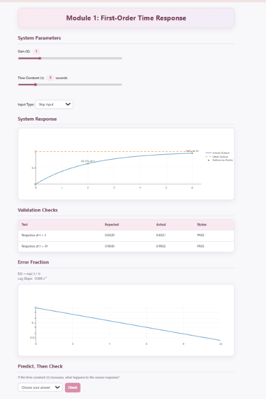
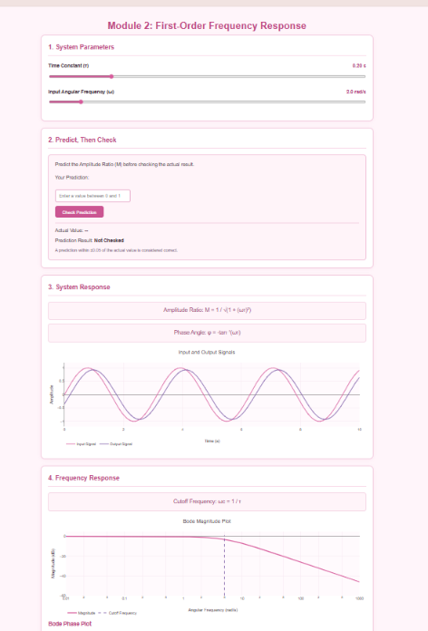
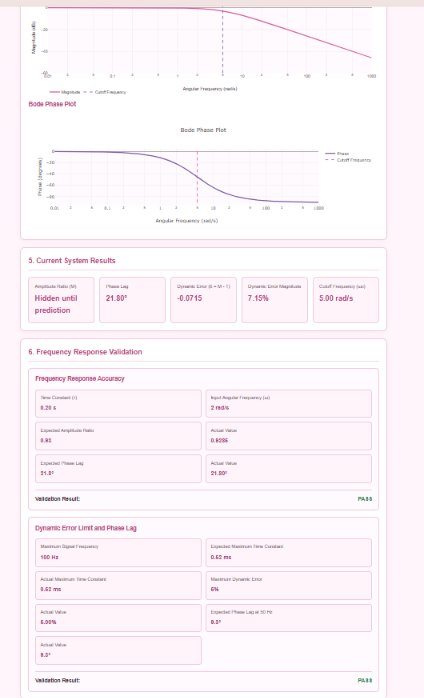
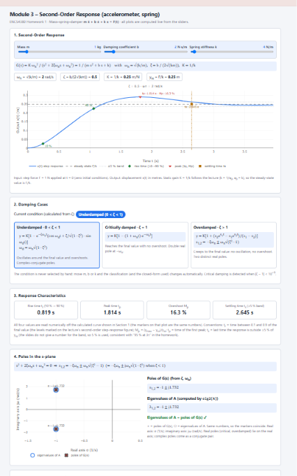
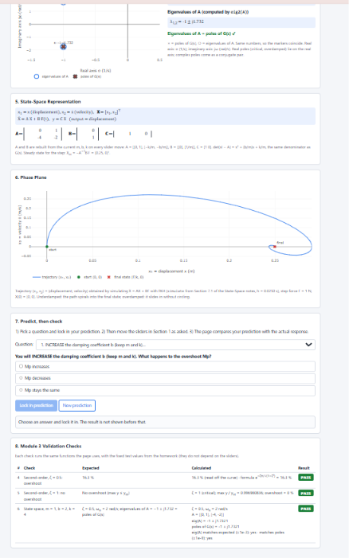

# Dynamic Characteristics Interactive Toolkit

An interactive web-based toolkit developed for ENCS4380 – Interfacing Techniques at Birzeit University.
## Live Demo

[Open the Interactive Toolkit](https://yaqeensalameh-rgb.github.io/ENCS4380-Dynamics-T04/)

## Team Members
- Yaqeen Salameh
- Leen Badran
- Reem Tirawi
- Nora Issam

## Project Overview

This project helps users understand the dynamic characteristics of sensors through interactive simulations, real-time plots, and parameter adjustments.

## How to Use the Toolkit

1. Open the Live Demo using the link provided above.
2. Select one of the four available modules.
3. Adjust the sliders to change system parameters where available.
4. Observe the response curves and plots.
5. Use the prediction section to estimate the expected behavior before checking the result.
6. Compare the results with the theoretical values and validation checks.

## Modules

- **[Module 1 – First-Order Time Response](https://yaqeensalameh-rgb.github.io/ENCS4380-Dynamics-T04/First_Order_time_Response_M1.html):** Explores step and ramp responses and the effect of the time constant (τ).
- **[Module 2 – First-Order Frequency Response](https://yaqeensalameh-rgb.github.io/ENCS4380-Dynamics-T04/module2%20%282%29.html):** Demonstrates amplitude ratio, phase lag, Bode plots, and dynamic error.
- **[Module 3 – Second-Order Response](https://yaqeensalameh-rgb.github.io/ENCS4380-Dynamics-T04/module3.html):** Explores damping conditions, response characteristics, poles, and state-space modeling.
- **[Module 4 – Guess the Sensor](https://yaqeensalameh-rgb.github.io/ENCS4380-Dynamics-T04/module4.html):** Challenges users to estimate unknown sensor parameters from response curves.

## Validation

The toolkit includes all six validation checks specified in the homework instructions.

## Technologies
- HTML
- CSS
- JavaScript
- Plotly.js
- GitHub Pages

## Work Distribution

| Module | Responsible Member |
|---|---|
| Module 1 | Leen Badran |
| Module 2 | Yaqeen Salameh |
| Module 3 | Reem Tirawi |
| Module 4 | Nora Issam |

## AI Usage

AI tools were used for assistance with code development, debugging, and code explanations. All implementations were reviewed and tested by the team.
## Screenshots

### Module 1 – First-Order Time Response

### Module 2 – First-Order Frequency Response

### Module 3 – Second-Order Response

## Learning Objectives

### Module 1 – First-Order Time Response
- Understand the meaning and importance of the time constant (τ).
- Identify the 63.2% response point at t = τ.
- Understand the 95% response point at t = 3τ.
- Compare step and ramp input responses.
- Analyze the effect of τ on sensor response speed.
- Understand the steady-state error and ramp lag.

### Module 2 – First-Order Frequency Response
- Understand how a first-order sensor responds to sinusoidal inputs.
- Calculate the amplitude ratio and phase lag.
- Explore the relationship between input frequency and output amplitude.
- Understand the cutoff frequency (ω = 1/τ).
- Interpret the Bode magnitude and phase plots.
- Calculate the dynamic error of a sensor.

### Module 3 – Second-Order Response
- Understand the effect of damping ratio (ζ) and natural frequency (ωn).
- Compare underdamped, critically damped, and overdamped responses.
- Analyze rise time, peak time, maximum overshoot, and settling time.
- Understand the relationship between system poles and response behavior.
- Explore the mass-spring-damper system using state-space representation.
- Observe the system trajectory in the phase plane.

### Module 4 – Guess the Sensor
- Develop the ability to identify unknown sensor characteristics from response curves.
- Estimate the time constant (τ) of a first-order system.
- Estimate the damping ratio (ζ) and natural frequency (ωn) of a second-order system.
- Use overshoot and peak time to analyze second-order responses.
- Compare estimated parameters with the actual hidden values.
- Improve understanding through interactive challenges and scoring.

## Project Learning Outcomes

By completing this toolkit, users can:
- Explain the dynamic behavior of first-order and second-order systems.
- Predict sensor responses to different input signals.
- Interpret time-domain and frequency-domain characteristics.
- Estimate unknown system parameters from response curves.
- Understand the connection between mathematical models, plots, and real sensor behavior.
